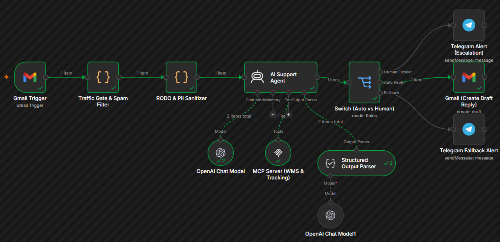
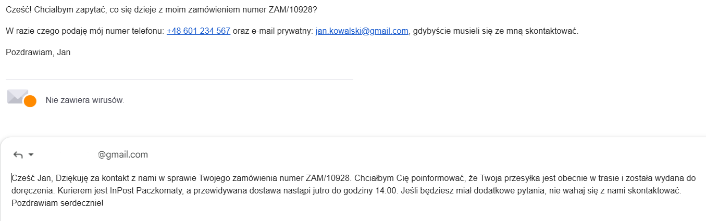
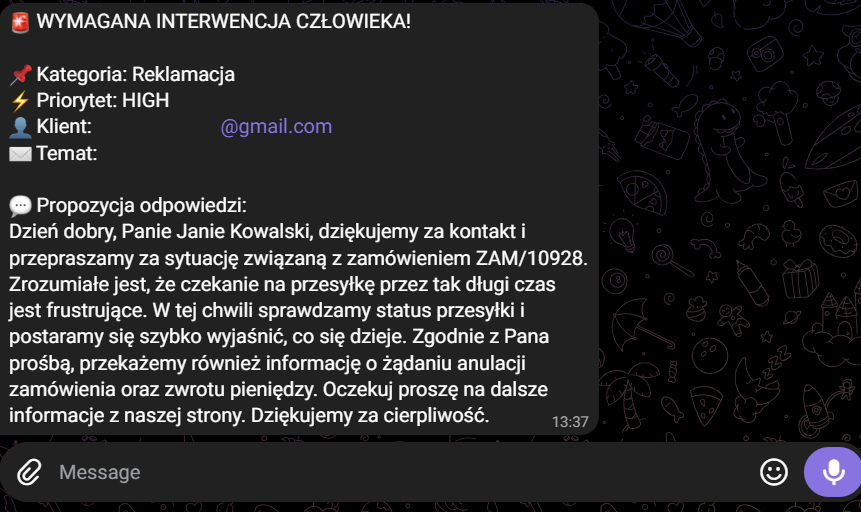

# 📬 Enterprise AI Ticketing & Order Routing Engine (n8n + FastMCP + OpenAI)

[](LICENSE)
[](https://n8n.io/)
[](https://github.com/jlowin/fastmcp)
[](https://openai.com/)
[](https://www.docker.com/)
[](https://telegram.org/)

An autonomous, multi-stage customer support pipeline designed to process incoming customer emails, enforce strict GDPR/RODO PII sanitation, execute tool calling via the Model Context Protocol (MCP) against a live WMS backend, and route decisions deterministically between auto-drafting replies and human escalation.

---

## ⚡ Key Engineering Highlights

* **Pre-LLM Traffic & Spam Gate:** Filters out non-support noise (newsletters, out-of-office autoreplies, `List-Unsubscribe` headers, bulk precedence) before reaching the language model, preventing prompt budget depletion.
* **GDPR / RODO PII Masking:** An inline JavaScript regex sanitizer neutralizes personal contact data (emails, Polish standard phone numbers) prior to tokenization while preserving order reference IDs (e.g., `ZAM/10928`).
* **Tool-Augmented Retrieval via FastMCP:** When an order inquiry is detected, the agent autonomously executes the `get_order_status` tool exposed via a Server-Sent Events (SSE) FastMCP backend container.
* **Deterministic Fail-Safe Routing:** Leverages LangChain's Structured Output Parser enforcing strict JSON schemas. Tickets classified as disputes, refund demands, or complaints automatically trip the `requires_human` flag, escalating to a dedicated Telegram triage channel with a pre-compiled draft. Standard status queries generate non-destructive Gmail drafts for human verification before dispatch.
* **Dead-Letter Handling (Fallback):** Schema violations or output parsing anomalies are isolated into a fallback channel to eliminate silent failures.

---

## 🏗️ Architecture & Data Flow

```text
               +----------------------------------+
               |       Gmail Trigger (Unread)     |
               +----------------------------------+
                                │
                                ▼
               +----------------------------------+
               |   Traffic Gate & Spam Filter     |
               |   (Auto-Replies, Newsletters)    |
               +----------------------------------+
                                │
                                ▼
               +----------------------------------+
               |       RODO & PII Sanitizer       |
               |     (Masks Emails / Phones)      |
               +----------------------------------+
                                │
                                ▼
               +----------------------------------+
               |        LangChain AI Agent        | <---> [FastMCP Server (WMS)]
               |     (gpt-4o-mini + Tool Use)     |
               +----------------------------------+
                                │
                                ▼
               +----------------------------------+
               |     Structured Output Parser     |
               +----------------------------------+
                                │
                                ▼
               +----------------------------------+
               |       Deterministic Switch       |
               +----------------------------------+
                                │
               ┌────────────────┴────────────────┐
     requires_human = true             requires_human = false
               │                                 │
               ▼                                 ▼
   +-----------------------+         +-----------------------+
   |    Telegram Alert     |         |       Gmail API       |
   |  (Escalation Queue)   |         |  (Create Draft Reply) |
   +-----------------------+         +-----------------------+

```

* **Orchestration:** n8n configured with native LangChain nodes and persistent volume storage.
* **Microservices:** Containerized FastMCP Python 3.11 server communicating via Server-Sent Events (SSE) inside an isolated Docker bridge network.
* **LLM Engine:** OpenAI `gpt-4o-mini` constrained to JSON outputs via LangChain Structured Output Parser.
* **Communication Layer:** Gmail API for draft creation and Telegram Bot API for real-time mobile triage.

---

## 📸 Workflow Topology & Proof of Work

### 1. n8n Execution Pipeline

The complete production-grade pipeline handling payload normalization, agentic tool invocation, and branching logic:



### 2. Autonomous WMS Ingestion & Draft Reply (Low Risk)

For standard order tracking queries, the agent queries the FastMCP WMS server, resolves shipping information, and stages an accurate email draft:



> *Figure 1: Automated customer draft staged via Gmail API incorporating live carrier ETA.*

### 3. Human Escalation Alert (High Risk / Dispute)

For chargeback threats, complaints, or refund demands, the engine escalates immediately without autonomous customer contact:



> *Figure 2: Real-time dispute brief dispatched to support team with AI-suggested co-pilot response.*

---

## 📂 Directory Structure

```text
├── assets/
│   ├── gmail_draft_reply.png
│   ├── n8n_workflow_canvas.png
│   └── telegram_escalation_alert.png
├── docs/
│   ├── mcp_server_spec.md
│   └── telegram_alert_schema.json
├── mcp_server/
│   ├── Dockerfile
│   ├── requirements.txt
│   └── server.py
├── workflow/
│   └── ai_ticketing_engine.json
├── .env.example
├── .gitignore
├── docker-compose.yml
└── README.md

```

---

## 🚀 Local Deployment & Setup

### 1. Prerequisites

* Docker & Docker Compose
* OpenAI API Key (`gpt-4o-mini`)
* Telegram Bot Token & Chat ID
* Google Cloud Console Credentials (Gmail OAuth2 API enabled)

### 2. Environment Configuration

Clone the repository and instantiate the environment variables:

```bash
git clone https://github.com/JohnStononloan/enterprise-ai-ticketing-engine.git
cd enterprise-ai-ticketing-engine
cp .env.example .env

```

Fill in the credentials in `.env`:

```ini
OPENAI_API_KEY=sk-proj-...
TELEGRAM_BOT_TOKEN=...
TELEGRAM_CHAT_ID=...
MCP_SECRET=your_generated_secret_key

```

### 3. Start Containers

Launch the infrastructure stack (n8n instance and FastMCP WMS service):

```bash
docker compose up -d --build

```

The services will be available at:

* **n8n Workflow Engine:** `http://localhost:5678`
* **FastMCP WMS Service:** `http://localhost:8000/sse`

### 4. Workflow Import

1. Navigate to your n8n workspace at `http://localhost:5678`.
2. Import the `workflow/ai_ticketing_engine.json` file.
3. Configure your credentials under **Credentials** (Gmail OAuth2, Telegram API, Header Auth for MCP).
4. Activate the workflow toggle.

---

## 🔒 Security & Data Hygiene

* **Zero Hardcoded Secrets:** Infrastructure tokens, MCP secret headers, and API keys are injected strictly via `.env` and secured n8n credential managers.
* **GDPR / RODO Compliance Gate:** Raw customer phone numbers and emails are stripped or masked prior to LLM tokenization to prevent data exposure.
* **Non-Destructive Operations:** Low-risk customer responses are created as **drafts**, requiring human validation prior to sending.
* **Fail-Closed Escalation:** High-friction tickets default strictly to human support via Telegram rather than risking automated hallucinated commitments.

```

```
